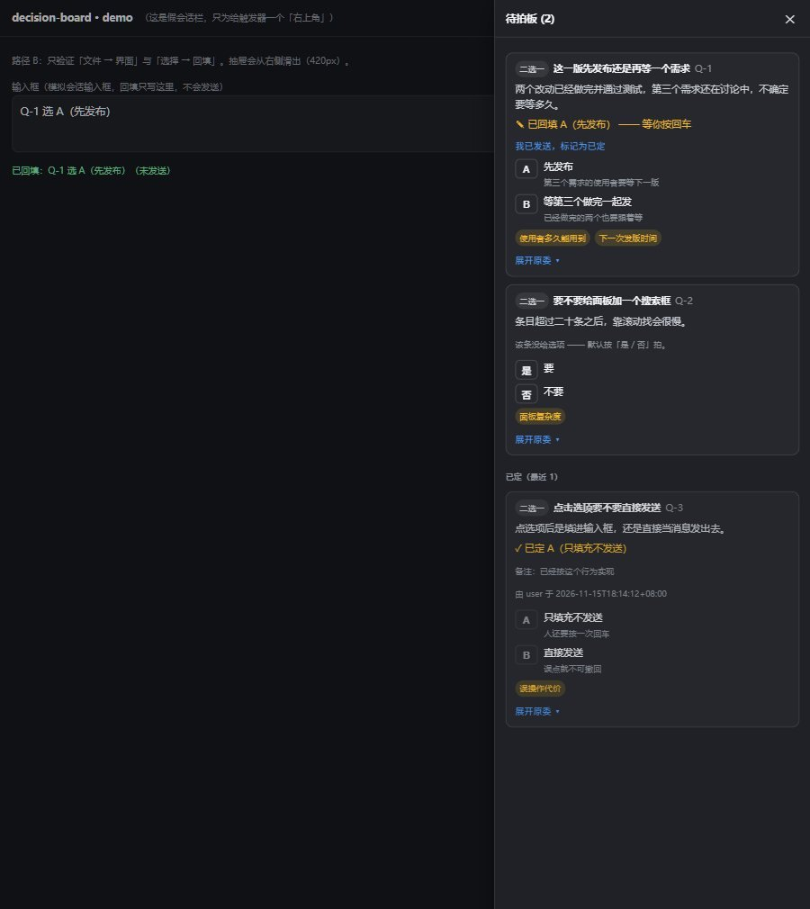

# dsh-decisions-board — 会话区右上角的「待拍板」看板

> 把「等人拍板的事项」从聊天记录里捞出来：**角标显示待决数，点开是按原委组织的清单，
> 选一个只回填输入框，按回车才发送**。数据源只有一个可 diff 的本地 JSON。

DSH 插件，独立仓库、零运行时依赖；宿主半与浏览器半都在这里。

## 即插即用吗：是（0.3.0 起）

装上并重启后：

| 谁 | 做什么 | 你需要额外做什么 |
| --- | --- | --- |
| 插件 | 往系统提示注入一段格式约定（:::decisions 块） | 无 |
| agent | 每当要你拍板，就在消息末尾写那段块 | 无（它照提示做） |
| 插件 | 监听 assistant/message，把块自动变成看板条目 | 无 |
| 你 | 看板点选、或回一句 Q-1 选 B | 无 |
| 插件 | 收到你的回答后自动收口（by: user-message） | 无 |

⇢ **不需要改任何项目配置，也不需要 agent 记得调工具。**

### 它怎么看见的（这条边界必须说清）

- 插件往系统提示加了一段：要拍板时写一个以 :::decisions 起、以 ::: 收的 JSON 块；
- 它**只解析这段标记块**：块外的正文不读、不存、不外传；
- 没有标记就什么都不抓 —— 会话里到处是「A 还是 B」，猜就会污染看板；
- 不想要这套自动化：autoCapture: false（退回「agent 显式 action=add」）。

### 仍然保留的两条手动路

- decisions_board action=add ...：你或 agent 想精确控制时用（id 自动编号、写前校验）；
- 直接编辑 <会话工作目录>/.dsh/decisions/<sessionId>.json。

## 长什么样

| 完整抽屉 | 「要不要」型（默认给是/否） | 已回填但还没发送 |
| --- | --- | --- |
|  |  |  |

（三张都是真机截图：路径 B 的验证页，真 Chromium + 真文件。）

用包里的示例数据直接跑，看到的就是这样（`examples/decisions.sample.json`）：



## 它能做什么

| 能力 | 具体行为 |
| --- | --- |
| 角标 | 会话标题行右侧显示 `⚖ 待拍 N`，N = `decisions.json` 里 `status=pending` 的条数 |
| 抽屉 | 点角标从右侧滑出 420px 面板；每条卡片显示 **问题 / 选项 / 建议 / 代价 / 影响** |
| 展开原委 | `question` 全文、每个选项的代价、影响标签、文档链接、`source.quote` + 轮次 |
| 选择 | 点 `[A]` → 落入 **`filled`（已回填 · 待发送）** → 往输入框**填入**一句话（**不自动发送**）；卡片**留在清单里**，直到点「我已发送」才变 `decided` |
| 已定回溯 | 已定条目保留最近 5 条，仍可展开看原委与人类原话 |
| 新增待拍项 | `decisions_board action=add title=... options=[...]` —— id 自动编号、文件/目录不存在自动建、写盘前先归一化校验（写歪的字段当场报错，不会静默丢弃） |
| 三条收口路径 | ① **自动**（默认开）：订阅宿主的 `session/event`，人在会话里发出答案 ⇒ 立刻 `decided`；② 人点「我已发送，标记为已定」；③ agent 调 `decisions_board action=settle`。三者写入规则与复述句完全一致，`decided.by` 分别记 `user-message` / `YG` / `agent` |

## 硬边界（设计红线）

1. **不替人决定**：不自动选、不自动发送；`inputActions.submit()` 永远不调。
2. **不读会话正文（仅一个例外）**：只解析 assistant 消息里的 `:::decisions` 标记块；
   **块外文本一律不读、不存、不外传**，也不写会话历史、不做摘要。要连这个例外也关掉：`autoCapture: false`。
3. **插件只改 `decided` / `status`**：其余字段只读，避免插件成为第二份真值。
4. **不静默丢板**：点选项只写 `status: "filled"`（已回填 · 待发送），条目**继续留在待拍清单**；
   只有人点「我已发送」或 agent 看到回答后写入，才落 `decided`。理由：回填可能被别的插件吞掉、
   人也可能不按回车 —— 那时看板若已把条目移走，这条决策就静默消失了。
5. **不改 `app.asar`**：走 Plugin Manager 通道安装。
6. **不碰会话共享的可写方法**：填充走 `setDraft`，**不用** `insertText` ——
   后者会被别的插件猴补丁（实测 `dsh-voice-plus` 会把它变成「转写→LLM 校对→延迟写回」），
   导致文本被改写或丢失。
7. **自动收口读什么、不读什么**：只在宿主 `session/event` 的 `user/message`（且 `source.kind === "user"`）上
   取消息文本，且**只用来匹配「id 选 值」这个我们自己造出来的形态**；不落盘原文、不外传、不用来推断别的语义。
   认不出就不动 —— 条目留在 `filled` 里可见。要彻底关掉：`autoSettle: false`。
8. **不做跨会话总览** —— 会话隔离是有意的：同一工作区的不同会话各看各的。
   `Q-2` 已定 **B 保持严格隔离**（2026-11-15，`by: user-message`），别再提「要不要加总览」这一条。

## 数据文件

```text
<会话工作目录>/.dsh/decisions/<sessionId>.json   # 默认：**会话级**，一个会话一份
```

> ⚠️ 早期版本用的是工作区级单文件 `<工作区>/.dsh/decisions.json` —— 那会让同一工作区的两个会话共用一块板子。
> 0.1.8 起改为按会话拆文件；旧文件不再读取，需要保留请手工按会话拆分。

解析顺序（宿主半）：`?dir=<绝对目录>` → 插件配置 `file` → 该会话的 workspace 目录 → 宿主 workspaceRoot。
字段含义见下方「数据文件」；`source.quote` 存人类原话一小段（≤80 字），`links` 只放引用不放正文。

## 目录

| 路径 | 作用 |
| --- | --- |
| `src/model.js` | **纯逻辑**：校验/归一化、\`pendingCount\`、\`composeFill\`、\`withDecision\`（有单测） |
| `src/panel.js` | **界面**（原生 DOM）：触发器 + 抽屉；路径 A 与路径 B 共用同一份 |
| `lib/index.js` | 宿主半：读/写 `decisions.json`，起 `/api/decisions-board/{state,decide}` |
| `lib/client.js` | 浏览器半，**由 `tools/build-client.mjs` 生成**（内联 model+panel），勿手改 |
| `tools/build-client.mjs` | 打包前必跑；内联后自检「不得残留 import/export」 |
| `tools/serve.mjs` | **路径 B** 零依赖本机小页（先验证数据与交互，再套插件壳） |
| `public/` | 路径 B 的页面 |
| `tests/` | `node --test`：模型 12 条 + 产物 3 条（含「注册到正确 slot」的守卫） |
| `tools/asar.py` | 只读解析 `app.asar` 索引（`DATA = 8 + headerPickleSize`），取证用 |
| `docs/R1-slot-research.md` | R-1 取证：右上角到底能不能注册、注册到哪个 slot |

## 开发命令

```powershell
cd <本仓库>
node --test tests/model.test.mjs tests/bundle.test.mjs tests/host.test.mjs tests/client.test.mjs
node tools/build-client.mjs                              # 改完 src/ 必跑
node tools/serve.mjs --file "<工作区>/.dsh/decisions/<sessionId>.json"   # 端口随机
```

> ⚠️ 路径 B 的端口是**随机**的（`listen(0)`），打印出来的 URL 才是本次的 ——
> 不要写死端口，并行会话会互相污染。
> ⚠️ 客户端插件热更需要 `pnpm run dev:web`；否则改完 `lib/client.js` 必须重启 Harness。

## 给同事：三步装上

```powershell
# 1) 拿到 tgz 后，让 agent 装（推荐）
#    在任意会话里说：装这个本地插件 <tgz 绝对路径>
#    agent 会调 install_local_workbench({ path, replace })

# 2) 看返回的 application
#    applied        → 已经生效，直接看会话区右上角
#    restart-required → 菜单「Harness → 重启 Harness」（不必退出 Desktop）

# 3) 自己确认装好了
#    会话标题行右侧出现「⚖ 待拍 N」；点开是抽屉。
#    或者让 agent 调 `decisions_board action=list`，能返回 file 路径即通。
```

**装好之后不需要改任何项目配置**：数据在 `<会话工作目录>/.dsh/decisions/<sessionId>.json`，
文件不存在就是空板子；agent 用 `decisions_board action=add` 写第一条。

### 装完怎么试（不碰真实数据）

```powershell
node tools/serve.mjs --file "<repo>\examples\decisions.sample.json"
```

打开它打印的随机端口，能看到三条示例的完整交互（见 `examples/README.md`）。

## 加入插件市场（awesome-dsh-plugin）

仓库：<https://github.com/Sandwich-git/dsh-decisions-board>

投稿只需要**一个 YAML 文件**（`data/plugins/<owner>__dsh-decisions-board.yml`），
完整步骤、卡点与自查表见 [docs/marketplace-submit.md](docs/marketplace-submit.md)，
单条内容见 [marketplace/OWNER__dsh-decisions-board.yml](marketplace/OWNER__dsh-decisions-board.yml)。

三道硬门槛里有两道靠**时间/账号**，不是靠写代码：

1. 仓库推到 GitHub 公开；
2. **建仓满 24 小时**（CI 自动查 `created_at`，不足即红）；
3. 仓库 About 加 `dsh-plugin` topic。

我们已满足：`dsh.bundle` 声明、真实可用代码、描述逐句对得上代码、非聚合包、PR 只加 1 条。

## 安装

```powershell
npm pack        # 生成 dsh-decisions-board-0.1.0.tgz（≤ 8 MiB）
```

然后由 agent 调 `install_local_workbench({ path: '<tgz 绝对路径>', replace: false })`。
清单硬要求（`dsh-desktop-workbenches/local-install.mjs:31-37`）：
`dsh.bundle.patch` + `dsh.client.platform === 'web'` + `dsh.client.inject` 含 `dsh-desktop-workbenches` + `exports['./client']`。

## 卸载

profile 的 `package.json` 删依赖与 `dsh.profile.bundles` 项 → 重启 Harness。
`decisions.json` 是用户数据，卸载不删。