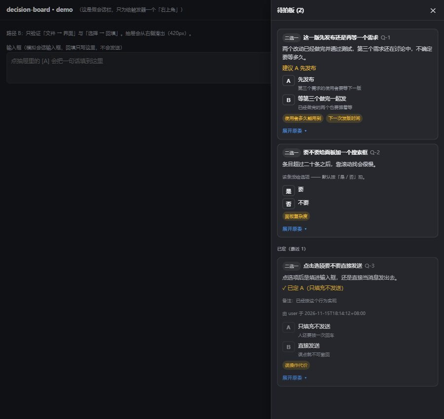
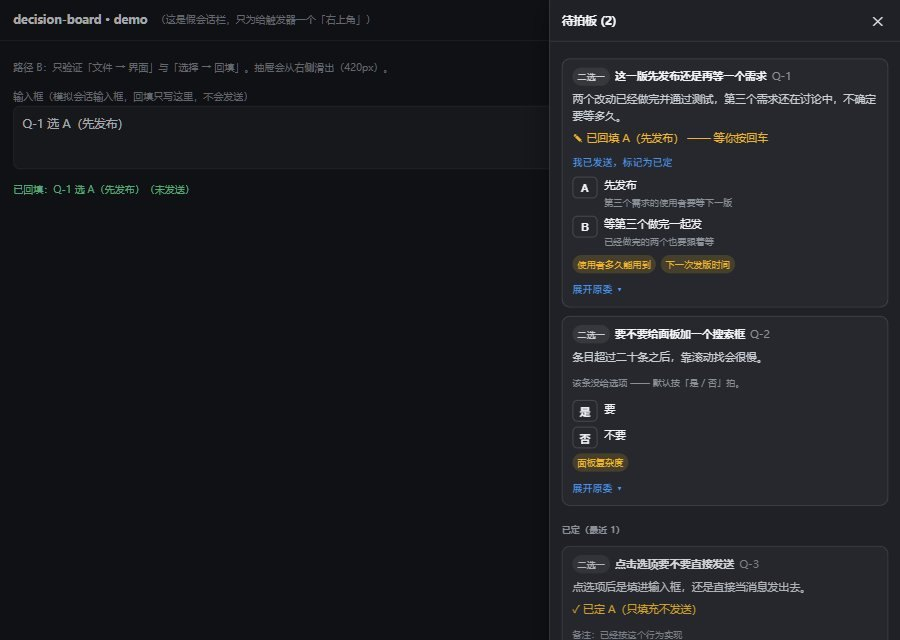
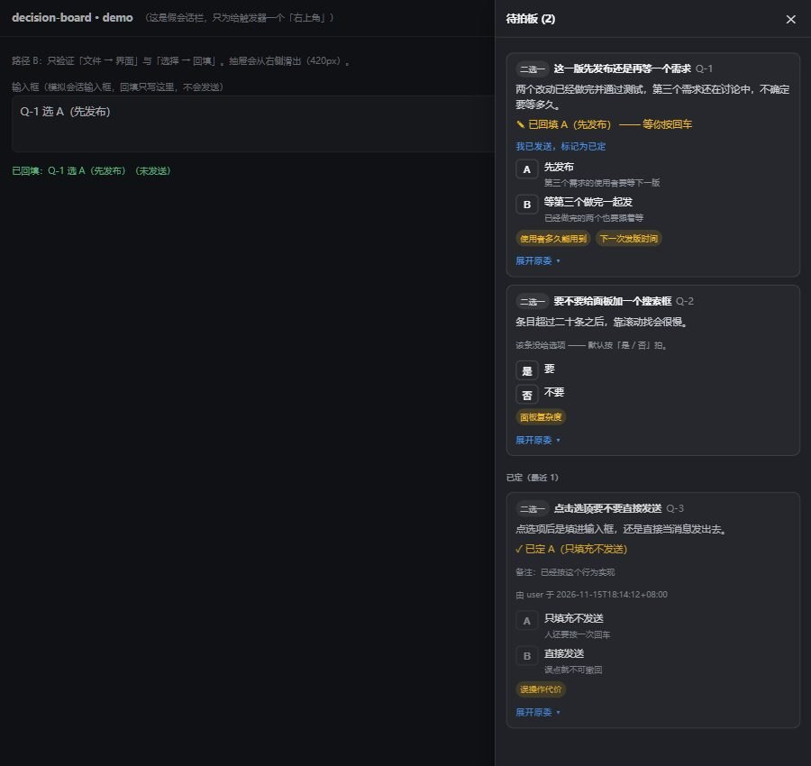

# dsh-decisions-board

在 DSH 会话标题行右侧加一块「待拍板」看板：agent 提问时把决策记进去，你从清单里点一个，
它只把 `Q-2 选 B` 这样的回复**填进输入框**，按回车才真正发送。数据是一个可 diff 的本地 JSON。

零运行时依赖；宿主半与浏览器半都在本仓库。

## 长什么样

| 完整抽屉 | 「要不要」型（默认给是/否） | 已回填但未发送 |
| --- | --- | --- |
|  |  |  |

用仓库里的示例数据跑，看到的就是这样：


## 安装

需要一个能装本地插件的 DSH Desktop（Plugin Manager 通道）。

```powershell
npm pack   # 产出 dsh-decisions-board-<version>.tgz（远小于 8 MiB 上限）
```

然后让 agent 调一次工具即可（在任意会话里说「装这个本地插件 <tgz 绝对路径>」）：

```js
install_local_workbench({ path: '<tgz 绝对路径>', replace: false })
```

看返回的 `application`：`applied` 表示已生效；`restart-required` 则走菜单「Harness → 重启 Harness」。
装好后会话标题行右侧会出现角标 `⚖ 待拍 N`。

清单硬要求（安装器会校验）：`dsh.bundle.patch` + `dsh.client.platform === 'web'` +
`dsh.client.inject` 含 `dsh-desktop-workbenches` + `exports['./client']` —— 本包都已声明。

卸载：profile 的 `package.json` 删依赖与 `dsh.profile.bundles` 项后重启。
**用户数据不会被删**（在 `.dsh/decisions/` 下）。

## 用法

### 条目怎么进来

两条路，都不需要改你的项目配置：

| 路径 | 谁触发 | 说明 |
| --- | --- | --- |
| **自动捕获**（默认开） | agent 写 `:::decisions` 块 | 插件往系统提示注入一段格式约定，agent 要你拍板时会照着写；插件解析该块并落盘 |
| **显式工具** | agent 调 `decisions_board` | `action=add title=… options=[…]`；id 自动编号、文件/目录不存在自动建、写盘前先归一化校验 |

标记块的形态：

:::decisions
{"kind":"choice","title":"一句话说明要拍什么","question":"为什么","options":[{"key":"a","label":"方案甲","cost":"代价甲"}],"recommended":"a","impact":["影响"],"quote":"人的原话"}
:::

一条消息可以有多块；`title` 必填；「要不要」型把 `options` 写成空数组，看板会给是/否。

### 怎么收口

三条路，写入规则与复述句完全一致，`decided.by` 分别记为 `user-message` / `user` / `agent`：

1. **自动**（默认开）：你在会话里发出答案（如 `Q-2 选 B`）⇒ 插件订阅 `session/event` 的 `user/message`，立刻标 `decided`；
2. **人点确认**：点卡片上的「我已发送，标记为已定」；
3. **agent 收口**：agent 调 `decisions_board action=settle`。

点选项本身**只写 `filled`（已回填 · 待发送）**，条目继续留在清单里 —— 见下方第 3 条边界。

## 数据文件

```text
<会话工作目录>/.dsh/decisions/<sessionId>.json
```

**一个会话一份**，互不可见。文件不存在 = 空板子（不报错、不猜）。读取顺序：
`?dir=<绝对目录>` → 插件配置 `file` → 该会话的 workspace 目录 → 宿主 `workspaceRoot`。

| 字段 | 说明 |
| --- | --- |
| `id` | 稳定锚点，跨文件引用靠它；自动编号形如 `Q-1` |
| `kind` | `caliber` / `scope` / `contract` / `priority` / `choice`（显示为 标准/范围/约定/优先级/二选一） |
| `status` | `pending` 待拍 · `filled` 已回填 · `decided` 已定 · `deferred` 后置 · `cancelled` 取消 |
| `title` / `question` | 一句话说明 + 为什么需要拍 |
| `options[]` | `{ key, label, cost }`；`cost` 缺失会被显式标成「未给代价」，不静默省略 |
| `recommended` | 建议选项的 `key` |
| `impact` / `links` | 影响标签 / 引用（只放链接，不放正文） |
| `source` | `{ turn, anchor, quote }`；`quote` 存人的原话一小段（≤80 字） |
| `decided` | `{ value, at, by, note }` |

## 配置

`cordis.patch.yml` 里三个开关：

| 键 | 默认 | 作用 |
| --- | --- | --- |
| `file` | 空 | 固定数据文件路径（覆盖按会话推导） |
| `autoCapture` | `true` | 注入 `:::decisions` 格式约定 + 订阅 `assistant/message` 自动建条目 |
| `autoSettle` | `true` | 订阅 `user/message`，人一发答案就自动收口 |

## 设计边界（它刻意不做的事）

1. **不替人决定**：不自动选、不自动发送；`inputActions.submit()` 永远不调。
2. **不读会话正文**（仅一个例外）：只解析消息里的 `:::decisions` 标记块；块外文本一律不读、不存、不外传，
   也不写会话历史、不做摘要。要连这个例外也关掉：`autoCapture: false`。
3. **不静默丢板**：点选项只写 `filled`，条目继续留在清单。理由：回填可能被别的插件吞掉，人也可能不按回车 ——
   那时看板若已把条目移走，这条决策就静默消失了。
4. **只改 `decided` / `status`**：其余字段只读，避免插件成为第二份真值。
5. **不碰会话共享的可写方法**：填充走 `setDraft`，**不用** `insertText` ——
   后者会被别的插件猴补丁（实测 `dsh-voice-plus` 会把它变成「转写 → LLM 校对 → 延迟写回」），导致文本被改写或丢失。
6. **不改 `app.asar`**：只走 Plugin Manager 通道安装。
7. **自动收口只认一种形态**：消息文本仅用于匹配 `id 选 值`；认不出就不动，条目留在 `filled` 里可见。
8. **不做跨会话总览**：会话隔离是有意的 —— 同一工作区的不同会话各看各的板子。

## 已知限制

- 只在当前 DSH Harness 版本上验过；`systemPrompt.section()` 与 `session/event` 的形态若变，注入或捕获会失效；
- 浏览器半只在 Chromium 下测过；
- `dsh.client.inject` 依赖 `dsh-desktop-workbenches`，所以定位是 **Desktop 插件**；
- 抽屉里最多显示最近 5 条已定条目（更早的只在文件里）；
- 面板每 2000 ms 轮询一次自己的文件，外部改动最多延迟约 2 秒可见。

## 开发

```powershell
node --test tests/model.test.mjs tests/bundle.test.mjs tests/host.test.mjs tests/client.test.mjs  # 58 条
node tools/build-client.mjs   # 改完 src/ 必跑，产物 lib/client.js 勿手改
node tools/serve.mjs --file examples/decisions.sample.json   # 本地预览页，端口随机
```

- 预览页端口是**随机**的（`listen(0)`），用打印出来的 URL，别写死端口；
- 客户端插件热更需要 `pnpm run dev:web`；否则改完 `lib/client.js` 必须重启 Harness；
- 验证记录（十轮里抓到的缺陷、守卫会红的证明、运行时证据）见 [docs/VERIFICATION.md](docs/VERIFICATION.md)。

## 目录

| 路径 | 作用 |
| --- | --- |
| `src/model.js` | 纯逻辑：归一化/校验、计数、回填句、收口语义（有单测，不依赖宿主） |
| `src/panel.js` | 界面（原生 DOM）：触发器 + 抽屉；插件与本地预览页共用同一份 |
| `lib/index.js` | 宿主半：读写数据文件，提供 `/api/decisions-board/{state,decide}`，注册工具与事件订阅 |
| `lib/client.js` | 浏览器半，**由 `tools/build-client.mjs` 生成**（内联 model + panel），勿手改 |
| `tools/build-client.mjs` | 打包前必跑；内联后自检「不得残留 import/export」 |
| `tools/serve.mjs` + `public/` | 零依赖本地预览页（不装插件也能看界面） |
| `examples/` | 三条示例数据，配合预览页使用 |
| `docs/VERIFICATION.md` | 验证记录 |
| `docs/R1-slot-research.md` | 会话标题行 slot 的取证结论 |
| `tests/` | `node --test`：模型 / 产物 / 宿主 / 客户端，共 58 条 |

## 许可证

MIT，见 [LICENSE](LICENSE)。
